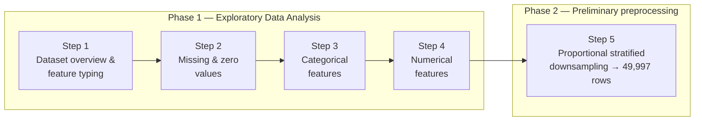
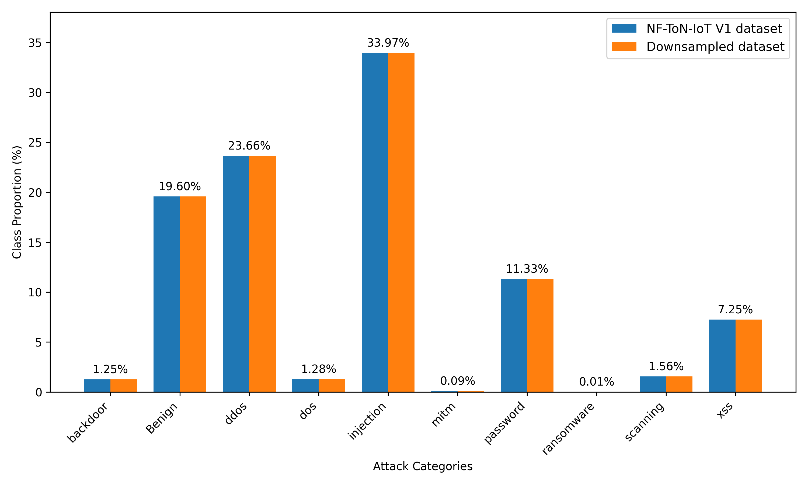
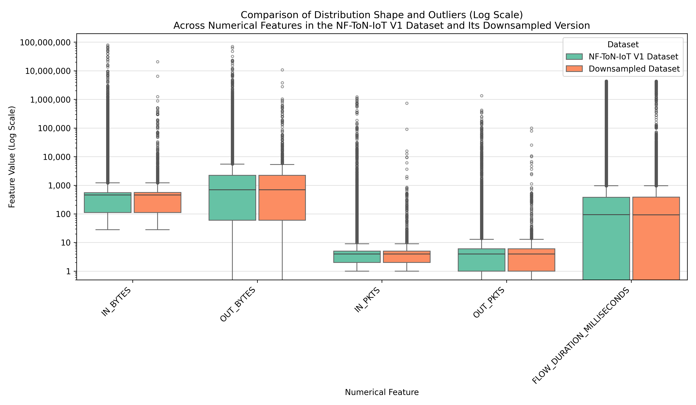
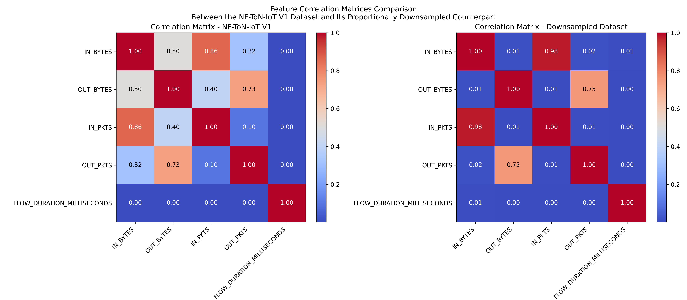
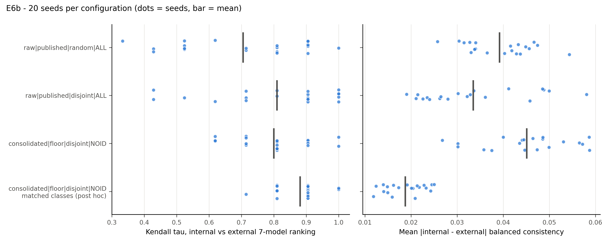
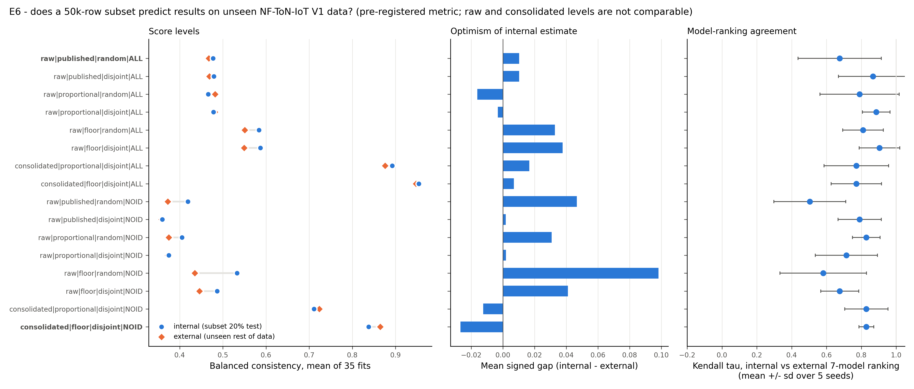

<div align="center">

# IoT-Attacks

### Reproducing and improving a preprocessing framework for ML-based IoT intrusion detection on NF-ToN-IoT


-complete-brightgreen)
-evaluated%2C%20refinement%20ongoing-yellow)


</div>

---

## Table of contents

1. [Project overview](#1-project-overview)
2. [The paper being reproduced](#2-the-paper-being-reproduced)
3. [Dataset](#3-dataset)
4. [The five-step framework](#4-the-five-step-framework)
5. [Task 1 – Reproduction results](#5-task-1--reproduction-results)
6. [Differences from the paper](#6-differences-from-the-paper)
7. [Implementation details the paper does not state](#7-implementation-details-the-paper-does-not-state)
8. [Observations made during reproduction](#8-observations-made-during-reproduction)
9. [Task 2 – Weaknesses, improved framework (LEAF) and evaluation](#9-task-2--weaknesses-improved-framework-leaf-and-evaluation)
10. [Repository structure](#10-repository-structure)
11. [How to run](#11-how-to-run)
12. [Data sources, licences and citation](#12-data-sources-licences-and-citation)

---

## 1. Project overview

This project has two tasks.

| Task | Goal | Status |
|---|---|---|
| **Task 1 – Reproduction** | Reproduce every reported result of a published paper from the original data, with code written from scratch. The authors released no code. | ✅ **Complete** |
| **Task 2 – Improvement** | Find the paper's weaknesses, propose a novel improvement, implement it and evaluate it. | ✅ Implemented and evaluated (E1–E6b); 🔶 floor refinement and second dataset pending |

**Task 1 headline results**

- **261 of 266** numbers reported in the paper are reproduced exactly (equal after rounding to the paper's precision).
- The 5 remaining differences are errors or inconsistencies **inside the paper itself**: one rounding slip and two minimum values that contradict the paper's own Table 2. See [Section 6](#6-differences-from-the-paper).
- Our downsampled dataset is **identical** to the one the authors published: all **49,997 rows, in the same order**.
- Figures 2, 3 and 4 of the paper are regenerated.

---

## 2. The paper being reproduced

> Martinez-Fuentes V., Arroyo A., Granados López D., Herrero A. (2026).
> **Toward AI-driven IoT cybersecurity: A preprocessing framework for benchmark datasets.**
> *International Journal of Information Security* 25:62. https://doi.org/10.1007/s10207-026-01235-z

**Problem the paper addresses.** Machine-learning models for IoT attack detection are trained and evaluated on public benchmark datasets. Before modelling, these datasets must be explored and prepared, but:

- there is **no standard, reproducible method** for doing this, and
- the datasets are **very large**, which makes experiments slow.

**Research questions.**

- **RQ1:** What are the distributional characteristics of the NF-ToN-IoT V1 dataset?
- **RQ2:** Can proportional downsampling preserve the distributional characteristics and relative class frequencies of the original dataset?

**Paper's conclusion.** Proportional stratified downsampling to about 3.6% of the data (49,997 flows) keeps the dataset's statistics and class proportions, so the subset is a "representative and analytically useful" basis for AI modelling.

---

## 3. Dataset

**NF-ToN-IoT V1** is a NetFlow version of the ToN-IoT dataset, released by the University of Queensland (Sarhan et al., 2021).

| Property | Value |
|---|---|
| Network flows (rows) | 1,379,274 |
| Attributes | 14 = 12 NetFlow features + 2 labels |
| `Label` (binary) | 0 = Benign, 1 = Attack |
| `Attack` (multiclass) | Benign + 9 attack types: backdoor, ddos, dos, injection, mitm, password, ransomware, scanning, xss |
| Missing values | None (no NaN, empty string or `-` placeholder in any column) |
| Official file SHA-1 | `ee8ee11c7e08bee0fb3d8d196d5c5fd2520a44d2`, verified automatically |

> The data is **not** stored in this repository, because of its size and its licence. `run_pipeline.py` downloads it from the official sources and verifies the checksum. See [Section 11](#11-how-to-run).

---

## 4. The five-step framework



| Step | What it computes | Code |
|---|---|---|
| 1 | Record and attribute counts; classifies each feature as numerical or categorical by its functional role (identifier, predefined category, quantitative) | [`repro/eda.py`](repro/eda.py) |
| 2 | Missing values (NaN, empty, `-`) and zero counts | [`repro/eda.py`](repro/eda.py) |
| 3 | Mode, Shannon entropy and top frequencies of categorical features | [`repro/eda.py`](repro/eda.py) |
| 4 | Descriptive statistics, skewness, kurtosis, IQR outlier ratio, Pearson correlations | [`repro/eda.py`](repro/eda.py) |
| 5 | For each class, `S_c = int(P_c × 50,000)` rows are sampled without replacement (`random_state = 42`) | [`repro/downsampling.py`](repro/downsampling.py) |

---

## 5. Task 1 – Reproduction results

### 5.1 Automatic comparison with the paper

Every number reported in the paper was typed into [`repro/paper_values.py`](repro/paper_values.py) and compared automatically with our output.

| Paper section | Matched | Checked |
|---|---|---|
| Step 1 | 2 | 2 |
| Step 2 | 1 | 1 |
| Table 2 | 36 | 36 |
| Table 3 | 21 | 21 |
| Sec 3.1.3 | 39 | 40 |
| Table 4 | 45 | 45 |
| Sec 4 | 1 | 1 |
| Table 5 | 26 | 30 |
| Table 6 | 40 | 40 |
| Table 7 | 30 | 30 |
| Fig 4 | 20 | 20 |
| **Total** | **261** | **266** |

The full check list is in [`results/tables/paper_vs_reproduced_all_checks.csv`](results/tables/paper_vs_reproduced_all_checks.csv). The generated report is [`results/reproduction_report.md`](results/reproduction_report.md).

### 5.2 Step 1–2: Feature classification and zero values (paper Table 2)

| Feature | Unique values | Functional role | Classification | Zero count | Zero % |
|---|---|---|---|---|---|
| IPV4_SRC_ADDR | 174 | Identifier | Categorical | 0 | 0.00 |
| IPV4_DST_ADDR | 1,478 | Identifier | Categorical | 0 | 0.00 |
| L4_SRC_PORT | 38,857 | Identifier | Categorical | 6,323 | 0.46 |
| L4_DST_PORT | 16,071 | Identifier | Categorical | 6,323 | 0.46 |
| PROTOCOL | 5 | Predefined category | Categorical | 0 | 0.00 |
| L7_PROTO | 97 | Predefined category | Categorical | 14,342 | 1.04 |
| IN_BYTES | 5,049 | Quantitative data | Numerical | 0 | 0.00 |
| OUT_BYTES | 5,140 | Quantitative data | Numerical | 147,823 | 10.72 |
| IN_PKTS | 921 | Quantitative data | Numerical | 0 | 0.00 |
| OUT_PKTS | 812 | Quantitative data | Numerical | 147,823 | 10.72 |
| TCP_FLAGS | 24 | Predefined category | Categorical | 127,790 | 9.27 |
| FLOW_DURATION_MILLISECONDS | 28,408 | Quantitative data | Numerical | 372,255 | 26.99 |

Missing values: **none** in any of the 14 columns ([`step2_missing_values.csv`](results/tables/step2_missing_values.csv)).

### 5.3 Step 3: Categorical features (paper Table 3)

Entropy is Shannon entropy in bits. Max entropy = log₂(number of categories).

| Feature | TCP/IP layer | Mode | Entropy | Max entropy |
|---|---|---|---|---|
| IPV4_SRC_ADDR | Internet | 192.168.1.31 | 3.215 | 7.443 |
| IPV4_DST_ADDR | Internet | 192.168.1.190 | 3.598 | 10.529 |
| PROTOCOL | Internet | 6 | 0.474 | 2.322 |
| L4_SRC_PORT | Transport | 443 | 13.095 | 15.246 |
| L4_DST_PORT | Transport | 80 | 3.681 | 13.972 |
| TCP_FLAGS | Transport | 27 | 2.568 | 4.585 |
| L7_PROTO | Application | 7.0 | 1.825 | 6.600 |

The top-5 value frequencies of every categorical feature are in [`step3_top_category_frequencies.csv`](results/tables/step3_top_category_frequencies.csv).

### 5.4 Step 5: Class distribution before and after downsampling (paper Table 4, Fig. 2)

| Class | Label | Full count | Full % | Subset count | Subset % | Abs. deviation (pp) |
|---|---|---|---|---|---|---|
| Benign | 0 | 270,279 | 19.60 | 9,797 | 19.60 | 0.00057 |
| backdoor | 1 | 17,247 | 1.25 | 625 | 1.25 | 0.00037 |
| ddos | 1 | 326,345 | 23.66 | 11,830 | 23.66 | 0.00078 |
| dos | 1 | 17,717 | 1.28 | 642 | 1.28 | 0.00044 |
| injection | 1 | 468,539 | 33.97 | 16,985 | 33.97 | 0.00207 |
| mitm | 1 | 1,295 | 0.09 | 46 | 0.09 | 0.00188 |
| password | 1 | 156,299 | 11.33 | 5,666 | 11.33 | 0.00070 |
| ransomware | 1 | 142 | 0.01 | 5 | 0.01 | 0.00029 |
| scanning | 1 | 21,467 | 1.56 | 778 | 1.56 | 0.00031 |
| xss | 1 | 99,944 | 7.25 | 3,623 | 7.25 | 0.00030 |
| **Total** | | **1,379,274** | 100 | **49,997** | 100 | max **0.00207** |

<p align="center"></p>
<p align="center"><em>Figure 2 (reproduced): class proportions in NF-ToN-IoT V1 and in the downsampled subset.</em></p>

**Verification against the authors' file.** Our subset was compared cell by cell with the CSV the authors published at the University of Burgos (doi:10.71486/wyx0-x933): **same shape (49,997 × 14), same columns, identical rows in identical order.**

### 5.5 Step 4: Numerical features, full vs subset (paper Tables 5–7)

| Feature | Data | Min | Max | Mean | Median | Std | Q1 | Q3 | Skewness | Kurtosis | Outlier ratio |
|---|---|---|---|---|---|---|---|---|---|---|---|
| IN_BYTES | Full | 28 | 79,415,904 | 1,466.23 | 458 | 177,963.17 | 112 | 554 | 315.76 | 110,425.10 | 0.0341 |
|  | Subset | 28 | 20,640,060 | 1,262.97 | 458 | 97,316.39 | 112 | 555 | 196.76 | 40,853.35 | 0.0330 |
| OUT_BYTES | Full | 0 | 70,165,175 | 2,745.43 | 696 | 110,558.95 | 60 | 2,239 | 431.08 | 227,684.79 | 0.0871 |
|  | Subset | 0 | 10,796,832 | 2,691.21 | 696 | 54,035.36 | 60 | 2,239 | 169.77 | 32,492.39 | 0.0882 |
| IN_PKTS | Full | 1 | 1,221,043 | 18.01 | 4 | 2,885.74 | 2 | 5 | 293.60 | 94,452.87 | 0.0379 |
|  | Subset | 1 | 737,145 | 22.41 | 4 | 3,323.75 | 2 | 5 | 218.59 | 48,393.98 | 0.0373 |
| OUT_PKTS | Full | 0 | 1,349,068 | 10.71 | 4 | 1,454.47 | 1 | 6 | 647.20 | 551,856.99 | 0.0186 |
|  | Subset | 0 | 99,744 | 9.77 | 4 | 584.29 | 1 | 6 | 149.44 | 23,482.00 | 0.0189 |
| FLOW_DURATION_MILLISECONDS | Full | 0 | 4,294,849 | 6,633.70 | 94 | 119,731.99 | 0 | 382 | 26.22 | 738.46 | 0.1659 |
|  | Subset | 0 | 4,294,849 | 7,555.84 | 92 | 132,476.33 | 0 | 383 | 24.43 | 635.56 | 0.1658 |

Std uses the sample estimator (ddof = 1). Skewness and kurtosis are the biased Fisher estimators (excess kurtosis). The outlier ratio uses the 1.5 × IQR rule. All values: [`tables5-7_numerical_full_vs_sub.csv`](results/tables/tables5-7_numerical_full_vs_sub.csv).

<p align="center"></p>
<p align="center"><em>Figure 3 (reproduced): distribution shape and outliers of the numerical features (log scale).</em></p>

### 5.6 Step 4: Correlations, full vs subset (paper Fig. 4)

| Feature pair | Full | Subset |
|---|---|---|
| IN_BYTES – OUT_BYTES | 0.50 | 0.01 |
| IN_BYTES – IN_PKTS | 0.86 | 0.98 |
| IN_BYTES – OUT_PKTS | 0.32 | 0.02 |
| IN_BYTES – FLOW_DURATION_MILLISECONDS | 0.00 | 0.01 |
| OUT_BYTES – IN_PKTS | 0.40 | 0.01 |
| OUT_BYTES – OUT_PKTS | 0.73 | 0.75 |
| OUT_BYTES – FLOW_DURATION_MILLISECONDS | 0.00 | 0.00 |
| IN_PKTS – OUT_PKTS | 0.10 | 0.01 |
| IN_PKTS – FLOW_DURATION_MILLISECONDS | 0.00 | 0.00 |
| OUT_PKTS – FLOW_DURATION_MILLISECONDS | 0.00 | 0.00 |

<p align="center"></p>
<p align="center"><em>Figure 4 (reproduced): Pearson correlation matrices of the numerical features.</em></p>

---

## 6. Differences from the paper

None of the 5 unmatched values is a reproduction failure.

| Item | Paper | Ours | Explanation |
|---|---|---|---|
| L7_PROTO top value % (Sec 3.1.3) | 59.31 | 59.32 | The exact value is 59.3151%. The paper truncates instead of rounding. |
| IN_BYTES min, full / subset (Table 5) | 0 / 0 | 28 / 28 | Contradicts the paper's own Table 2, which reports **0** zero-valued cells for IN_BYTES. The minimum therefore cannot be 0. |
| OUT_PKTS min, full / subset (Table 5) | 1 / 1 | 0 / 0 | Contradicts the paper's own Table 2, which reports **147,823** zeros for OUT_PKTS. The minimum therefore cannot be 1. |

---

## 7. Implementation details the paper does not state

These details had to be worked out to reproduce the published numbers exactly.

1. **Class-size rounding.** Applying Eq. 1, `S_c = int(P_c × 50,000)`, to the exact class proportions gives **49,995** rows, not 49,997. The published counts (e.g. injection 16,985 and password 5,666) come out only if each class percentage is **first rounded to 4 decimals**. This is `PERCENT_DECIMALS = 4` in [`repro/config.py`](repro/config.py).
2. **Sampling order.** `DataFrame.sample(n, random_state=42)` runs separately on each class in the original file order. The class subsets are concatenated in the order Benign, backdoor, dos, ddos, injection, mitm, password, ransomware, scanning, xss. This order reproduces the published file row for row.
3. **Zero counting.** Only the literal value `0` is counted as zero. The IP string `0.0.0.0` is not counted.
4. **Estimators.** Sample standard deviation (ddof = 1), linear-interpolation quartiles, `scipy.stats` skewness and kurtosis defaults (biased, Fisher), Pearson correlation, base-2 Shannon entropy.

---

## 8. Observations made during reproduction

These are facts from the reproduced numbers. They motivate Task 2. Every number in this section is recomputed by [`observations.py`](observations.py), which writes [`observations_correlation_sensitivity.csv`](results/tables/observations_correlation_sensitivity.csv).

1. **Some correlations are lost, not just "attenuated".** The paper calls these changes attenuation and concludes that the "correlation structures remained consistent". In the subset, however, IN_BYTES–OUT_BYTES drops from 0.50 to 0.01, OUT_BYTES–IN_PKTS from 0.40 to 0.01 and IN_BYTES–OUT_PKTS from 0.32 to 0.02 ([Section 5.6](#56-step-4-correlations-full-vs-subset-paper-fig-4)).
   The full-data values are driven by a handful of extreme flows, which a 3.6% sample is unlikely to contain:
   - Removing just the 5 largest flows by IN_BYTES and the 5 largest by OUT_BYTES (**8 distinct flows out of 1,379,274**) lowers IN_BYTES–OUT_BYTES on the full data from 0.503 to 0.179.
   - Removing 178 such flows lowers it to 0.109.
2. **Maximum values were not preserved.** Section 4 of the paper says *"The minimum and maximum values were preserved for all features"*. However, the paper's own Table 5, reproduced exactly above, shows a different maximum in the subset for 4 of the 5 numerical features. For example, OUT_PKTS falls from 1,349,068 to 99,744.
3. **Rare classes become very small.** Proportional sampling leaves only **5 ransomware** and **46 mitm** flows in the 49,997-row subset. That is too few to train or test a classifier reliably on these classes.
4. **Identifier features.** The paper classifies IP addresses and ports as *identifiers* (Table 2) but keeps them in the dataset. ML models can memorise such identifiers instead of learning attack behaviour.
5. **Unspecified addresses.** 309 flows use `0.0.0.0` as both source and destination IP. The paper does not mention them.
6. **No model was trained.** The paper's conclusion that the subset is useful for AI modelling rests only on statistical similarity. Scikit-learn is listed in its Table 1 only for future work.

---

## 9. Task 2 – Weaknesses, improved framework (LEAF) and evaluation

**Research question.** The paper shows that the subset *looks* statistically similar to the full dataset. Task 2 asks whether **machine-learning results** obtained on NF-ToN-IoT, and on its downsampled subset, are actually **trustworthy**, and how the framework should change so that they are.

Full design, hypotheses (fixed before the main run) and every result, including a failed hypothesis: [docs/task2_design.md](docs/task2_design.md). Experiment details: [LEAF_README.md](LEAF_README.md). Prior work and novelty check: [docs/novelty_check.md](docs/novelty_check.md).

### 9.1 Weaknesses found in the original framework

| # | Weakness | Evidence (all recomputed by the code in this repository) |
|---|---|---|
| W1 | Representativeness is judged only by statistics, never by models | No model is trained in the paper |
| W2 | No label-consistency check | 287,559 distinct records carry 2–5 attack labels; each label occurs equally often in 100% of them (E1b) |
| W3 | Four attack classes cannot be separated | dos, password, scanning and xss have **0** records that carry their label alone (295,427 rows, 21.4%) |
| W4 | Identifiers kept as features | IPs and ports alone give 0.9998 binary F1 (E2) |
| W5 | Rare classes almost vanish | 5 ransomware and 46 mitm rows in the subset; 1 ransomware row in a 20% test split |
| W6 | No leakage-safe split | In a random 80/20 split of the subset, 4.95% of test records (20 seeds: 4.63–5.26%) have an exact copy in training. Without identifiers this rises to 46.8% (`E6_split_leakage.csv`) |
| W7 | Some statistical claims overstated | See Section 8 |

### 9.2 Improved framework: LEAF preprocessing

The paper's Steps 1–5 are kept. LEAF adds:

- a duplicate and label-consistency audit;
- **label consolidation** (one record per distinct flow, with its set of candidate labels);
- identifier removal by default;
- floor-proportional sampling;
- a **leakage-safe split** (identical flows never on both sides);
- a **model-fidelity check** against unseen data.

For candidate-label data, models are scored by *balanced consistency*: a prediction counts as correct if it is one of the record's candidate labels. On ordinary single-label data this equals balanced accuracy, which is unit-tested against scikit-learn.

### 9.3 Main result (E6/E6b: 875 model fits)

A researcher takes a 50k subset, splits it 80/20 and compares 7 models (LR, DT, RF, ET, XGBoost, LightGBM, MLP). We check whether the internal scores and the model ranking hold on all the *unseen* records of NF-ToN-IoT V1.

<p align="center"></p>

| 20 seeds | Ranking agreement τ [95% CI] | Mean \|internal − external\| | Seed-to-seed sd |
|---|---|---|---|
| Paper's practice (published subset, random split, all features) | 0.705 [0.614, 0.791] | 0.0392 | 0.0468 |
| Published subset, leakage-safe split | 0.810 [0.724, 0.886] | 0.0335 | 0.0425 |
| Full LEAF, pre-registered metric | 0.800 [0.752, 0.848] | 0.0451 | 0.0217 |
| Full LEAF, scored on classes present on both sides (post hoc) | 0.881 [0.852, 0.910] | 0.0188 | 0.0156 |

What the results show, including where LEAF failed:

- **The paper's practice gives an unreliable model ranking.** τ is 0.705, and the best model on the subset is the best on unseen data in only 14 of 20 seeds (hypothesis H1: supported).
- **LEAF failed its pre-registered gap test.** Its floor sampling takes *every* ransomware record (and, without identifiers, every dos record) into the subset, so those classes cannot be checked on unseen data. The gap is larger, 0.0451 vs 0.0392, p = 0.034 (H3: rejected as pre-registered).
- **Scored on the same classes, LEAF halves the gap and ranks models more consistently.** This was tested on 15 seeds run *after* the comparison was defined: gap p = 3.4 × 10⁻⁶, τ p = 0.022. LEAF's internal scores are also about twice as stable across seeds.
- **The leakage-safe split alone helps in direction, but not significantly** (τ p = 0.11, gap p = 0.11, n = 20).
- **Removing identifiers does not improve agreement within this dataset.** Its purpose is to avoid the IP/port shortcut when moving to another network.

All 16 configurations of E6 (5 seeds each) are reported in `results/leaf/tables/E6_fidelity_summary.csv` and in the figure below.

<p align="center"></p>

### 9.4 Next steps

1. Fix the floor step so that every class keeps records outside the subset (proposed in [docs/task2_design.md](docs/task2_design.md) §4.3), and test it on fresh seeds.
2. Repeat on a second dataset (e.g. NF-ToN-IoT-v2 or NF-UNSW-NB15).
3. Publish the LEAF subset as row indices plus code; the data itself is not redistributed.

---

## 10. Repository structure

```
IoT-Attacks/
├── README.md                     this file
├── requirements.txt              Python dependencies
├── run_pipeline.py               Task 1 entry point: download → Steps 1–5 → figures → comparison report
├── observations.py               recomputes the observations in README Section 8
├── run_leaf.py                   Task 2 entry point: LEAF experiments E1–E6b
├── analyze_leaf.py               Task 2 analysis of E1–E5 (tables, figures)
├── LEAF_README.md                Task 2 experiment documentation and findings F1–F8
├── docs/
│   ├── task2_design.md           weaknesses, improved framework, E6 design, hypotheses, results
│   └── novelty_check.md          prior work and what is new
├── leaf/                         Task 2 package
│   ├── audit.py, forensics.py    integrity audit (E1) and replication forensics (E1b)
│   ├── partial.py                label consolidation and candidate-label metrics
│   ├── fidelity.py               E6/E6b: evaluation fidelity of reduced datasets
│   ├── analyze_e6.py             E6/E6b analysis (gaps, Kendall τ, tests, figures)
│   └── ...                       config, data, models, sampling, experiments (E2–E5)
├── repro/                        Task 1 package (written from scratch from the paper's text)
│   ├── config.py                 paths, official URLs, feature groups, seed, target size
│   ├── download.py               UQ RDM + UBU download, safe zip extraction, SHA-1 check
│   ├── eda.py                    Phase 1, Steps 1–4
│   ├── downsampling.py           Phase 2, Step 5 (and comparison with the published subset)
│   ├── plots.py                  Figures 2–4
│   ├── paper_values.py           every number reported in the paper, for automatic comparison
│   └── compare.py                reproduced-vs-paper checker
└── results/
    ├── reproduction_report.md    generated report
    ├── tables/                   all reproduced tables (CSV)
    ├── figures/                  reproduced Figures 2–4 (PNG)
    └── leaf/                     Task 2: raw per-fit results, tables, figures
```

`data/` is created locally by the pipeline and is not tracked (see [Section 12](#12-data-sources-licences-and-citation)).

---

## 11. How to run

**Requirements:** Python ≥ 3.11 (tested on 3.13) and about 150 MB of free disk space for the downloaded data.

```bash
git clone https://github.com/ali-Hamza817/IoT-Attacks.git
cd IoT-Attacks
pip install -r requirements.txt

python run_pipeline.py                # download the data (first run only), verify SHA-1, run Steps 1–5
python run_pipeline.py --no-download  # rerun with the data already on disk (about 15 s)
python observations.py                # recompute the Section 8 observations

# Task 2 (needs the data downloaded by run_pipeline.py)
python run_leaf.py all                # E1–E5 (several hours; resumable)
python run_leaf.py e1b e6 e6b         # forensics and fidelity experiments (about 2 h)
python analyze_leaf.py                # E1–E5 tables and figures
python -m leaf.analyze_e6             # E6/E6b tables, tests and figures
```

The pipeline:

1. downloads NF-ToN-IoT V1 from the University of Queensland and verifies its SHA-1;
2. downloads the authors' published subset from the University of Burgos, used **only** for verification;
3. runs Steps 1–5 and writes `results/tables/*.csv` and `results/figures/*.png`;
4. compares all 266 reported values with the paper and writes `results/reproduction_report.md`.

Tested with Python 3.13.0, pandas 3.0.3, NumPy 2.4.6, SciPy 1.17.1 and Matplotlib 3.10.9.

---

## 12. Data sources, licences and citation

The datasets are **not redistributed** here. They are downloaded from their official sources and are licensed for **non-commercial use only**.

- **NF-ToN-IoT V1.** University of Queensland Research Data Manager (dataset `2ad93cd0-ef9c-11ed-827d-e762de186848`), linked from https://staff.itee.uq.edu.au/marius/NIDS_datasets/. Cite:
  > Sarhan M., Layeghy S., Moustafa N., Portmann M. (2021). NetFlow Datasets for Machine Learning-Based Network Intrusion Detection Systems. *Big Data Technologies and Applications (BDTA 2020) / WiCON 2020*, Springer. https://doi.org/10.1007/978-3-030-72802-1_9
- **Downsampled NF-ToN-IoT V1.** University of Burgos, CC BY-NC-ND 4.0. Cite:
  > Martinez-Fuentes V., Granados López D., Arroyo A., Herrero A. (2025). Downsampled NF-ToN-IoT V1 Dataset. University of Burgos. https://doi.org/10.71486/wyx0-x933
- **Reproduced paper.** Martinez-Fuentes et al. (2026), *Int. J. Inf. Secur.* 25:62, https://doi.org/10.1007/s10207-026-01235-z (open access, CC BY-NC-ND 4.0).

All code in this repository was written independently from the paper's text. No code from the original authors was used; none was published.

---

<div align="center">

**Author:** Ali Hamza · MS Software Engineering, Military College of Signals

</div>
